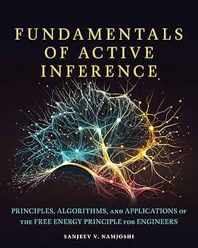

# Active Inference Institute — Organizational Website

[](https://activeinference.org/)
[(3)%20Nonprofit-green)](https://activeinference.org/)

The **Active Inference Institute** is a volunteer-led **501(c)(3) nonprofit** dedicated to improving the accessibility, rigor, and applicability of the **Free Energy Principle** and **Active Inference** through open-science principles. Founded in 2021 and co-founded by **Daniel Friedman**, the Institute supports a global community of researchers, students, engineers, and enthusiasts across education, research, and tool development.

This repository contains the Institute's public-facing organizational website, built as a static GitHub Pages site with no build step or bundler. The standalone simulations are self-contained HTML files; most load Google Fonts for typography.

---

## About Active Inference

**Active Inference** is a framework for modelling perception and action using generative models. Variational free energy is an upper bound on surprisal under a model; it is not a synonym for surprise. Perception updates beliefs about hidden causes, while action and policy selection depend on the model, prior preferences, and expected outcomes. The textbooks below develop these ideas and their assumptions; see also the mathematical formulation in [*Generalised free energy and active inference*](https://pmc.ncbi.nlm.nih.gov/articles/PMC6848054/).

---

## Key Resources

| Resource | Link |
|----------|------|
| **Website** | [activeinference.org](https://activeinference.org/) |
| **YouTube** | [youtube.com/c/ActiveInference](https://www.youtube.com/c/ActiveInference) |
| **Discord** | [discord.com/invite/FSUvYD2p9S](https://discord.com/invite/FSUvYD2p9S) |
| **GitHub** | [github.com/ActiveInferenceInstitute](https://github.com/ActiveInferenceInstitute) |
| **Symposium** | [symposium.activeinference.institute](https://symposium.activeinference.institute/) |
| **Email** | blanket@activeinference.institute |

### Textbooks

- **[Active Inference: The Free Energy Principle in Mind, Brain, and Behavior](https://mitpress.mit.edu/9780262045353/active-inference/)** — Thomas Parr, Giovanni Pezzulo & Karl Friston (MIT Press, 2022). The Institute hosts recurring [Textbook Group](https://textbook-group.activeinference.institute/) cohorts.
- **[Fundamentals of Active Inference: Principles, Algorithms, and Applications of the Free Energy Principle for Engineers](https://mitpress.mit.edu/9780262050951/fundamentals-of-active-inference/)** — Sanjeev V. Namjoshi (MIT Press, 17 March 2026 · ISBN 9780262050951). An engineering-focused introduction with worked examples and simulations. The 12 interactive simulations in this repository accompany this textbook.

<p align="center">
  
</p>

### Applied Active Inference Symposium Series

| Year | Edition | Theme | Link |
|------|---------|-------|------|
| 2021 | 1st | — | [Zenodo Record](https://zenodo.org/records/5797072) |
| 2022 | 2nd | Robotics | [Coda Page](https://coda.io/@active-inference-institute/2nd-applied-active-inference-symposium) |
| 2023 | 3rd | Enacting Ecosystems of Shared Intelligence | [Coda Page](https://coda.io/@active-inference-institute/3rd-applied-active-inference-symposium) |
| 2024 | 4th | — | [Program](https://coda.io/d/Applied-Active-Inference-Symposium-2024_dQa03zJJkvJ/Symposium-Program_surazvwP#Session-timestamps_tuN06EQq) |
| 2025 | 5th | Industry | [Program](https://coda.io/d/Applied-Active-Inference-Symposium-2025_d08cdDbWwRy/Symposium-Program_surazvwP#_luf3ZkIk) |
| 2026 | 6th | — | [Symposium hub](https://symposium.activeinference.institute/) |

---

## Directory Structure & Architecture

This repository uses a modular folder structure to enforce clean boundaries between core site pages and standalone applications.

```
aii-org/
├── index.html                      ← Home page (entry point)
├── site.css                        ← Shared design tokens
├── site-components.js              ← Shared navigation, header, footer logic
├── pages/                          ← Core static site pages
│   ├── history.html                ← History timeline
│   ├── vision-mission.html         ← Strategy & Goals
│   ├── bod.html                    ← Board of Directors
│   ├── sab.html                    ← Scientific Advisory Board
│   ├── simulations.html            ← Catalog index of demos
│   ├── research.html               ← Past, current & future projects
│   ├── education.html              ← Courses, textbook groups, internships
│   └── tools.html                  ← RxInfer.jl & open-source code
├── simulations/                    ← 12 standalone Canvas interactive demos
│   ├── Ink.html                    ← 100% independent HTML/JS applications
│   ├── Apple-Frog.html
│   ├── fep_surprise.html
│   ├── ...                           ← 12 catalogued demos plus experimental files
├── assets/                         ← Static payload (images, PDF)
│   ├── bod/                        ← BOD headshots
│   └── sab/                        ← SAB headshots
├── README.md                       ← This file
└── AGENTS.md                       ← Agentic context & conventions
```

### Technical Notes

- **No build system or bundler.** Pure HTML, CSS, and vanilla JavaScript.
- **No external dependencies in the core site.** Most standalone simulations load Google Fonts; no package installation is needed to view them.
- `site.css` → Design tokens, typography, header/footer styles.
- `site-components.js` → Injects the header, footer, canvas logos, and desktop/mobile navigation; resolves links from the root and inner pages with `basePath`.
- All `simulations/` are **standalone webapps** — inline styles and logic, rendering via the Canvas API with zero shared dependencies.

---

## Interactive Simulations

12 companion demos for the foundational textbooks, covering concepts from Bayesian inference to hierarchical Markov blankets. Each is a self-contained HTML file; most request Google Fonts. These are educational illustrations, not empirical validation of the framework. See [`simulations/README.md`](simulations/README.md) for a conceptual breakdown by difficulty level.

## Documentation

This repository keeps documentation close to the files it describes:

- [`pages/README.md`](pages/README.md) — core site pages and shared-component requirements.
- [`simulations/README.md`](simulations/README.md) — public simulation catalogue and experimental files.
- [`assets/README.md`](assets/README.md) — site media, documents, and asset subdirectories.
- [`assets/bod/README.md`](assets/bod/README.md) — Board of Directors headshots.
- [`assets/sab/README.md`](assets/sab/README.md) — Scientific Advisory Board headshots.
- [`AGENTS.md`](AGENTS.md) and directory-level `AGENTS.md` files — repository conventions for maintainers and automated agents.
- [`CONTRIBUTING.md`](CONTRIBUTING.md) — contribution, local preview, and pull-request guidance.
- [`docs/research-sources.md`](docs/research-sources.md) — primary-source records and editorial decisions for the research bibliography.
- [`scripts/check-site.mjs`](scripts/check-site.mjs) — local link, asset, and HTML fragment checks, including shared navigation; run with `bun scripts/check-site.mjs`.
- [`TO-DO.md`](TO-DO.md) — outstanding scoped work; completed items are removed.

---

See [`CONTRIBUTING.md`](CONTRIBUTING.md) for the complete contribution and local-development guide.

---

## License

This repository is licensed under the [Creative Commons Attribution 4.0
International licence (CC BY 4.0)](LICENSE). See `LICENSE` for the legal terms.

## InstituteOS sidecar

This repository carries a committed [`.aii/`](.aii/README.md) sidecar with curated
InstituteOS metadata (`aii-sidecar/v1`): category, maturity, ecosystem relations,
key artifacts, provenance, and portable tasks. It is read by
[InstituteOS](https://github.com/ActiveInferenceInstitute/InstituteOS) tooling and
does not affect the project's build or runtime.
